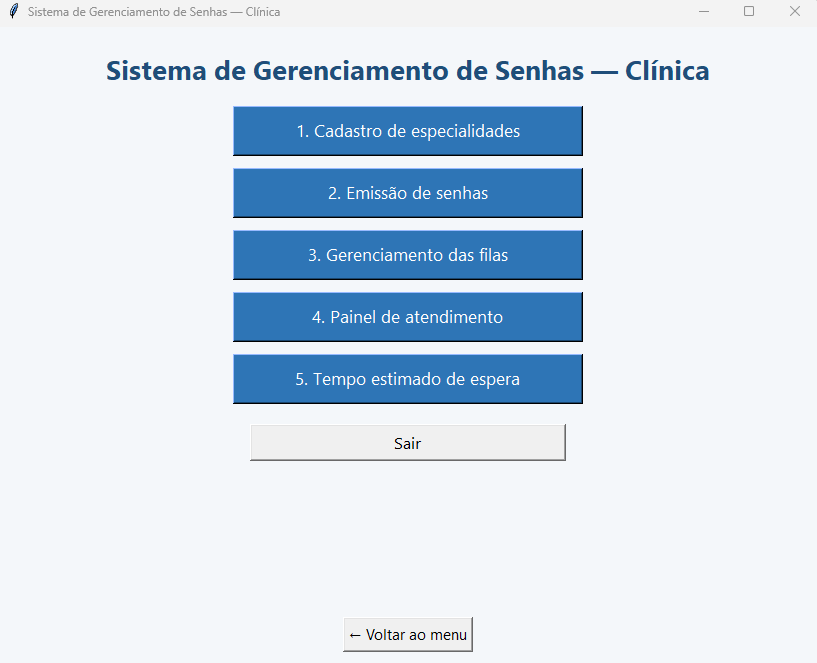
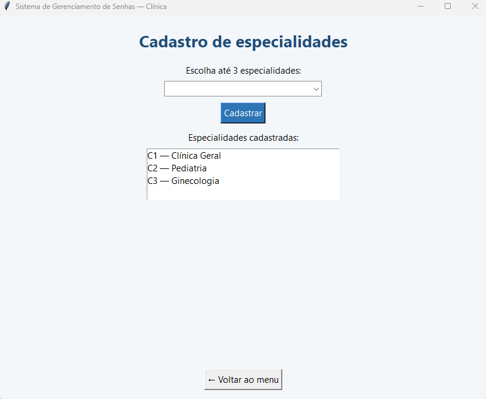
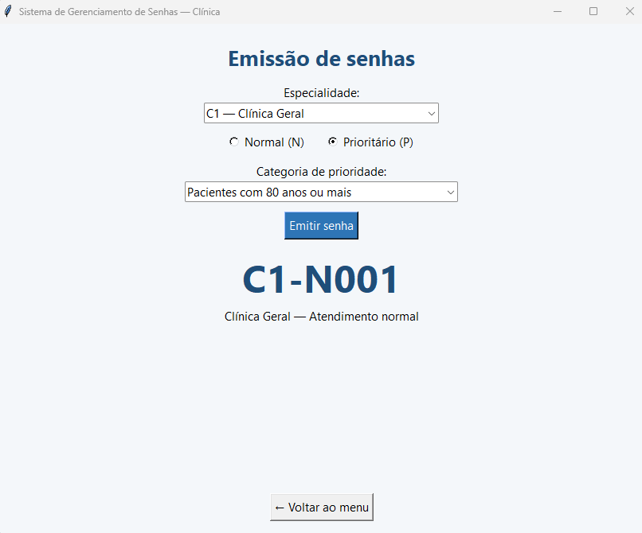
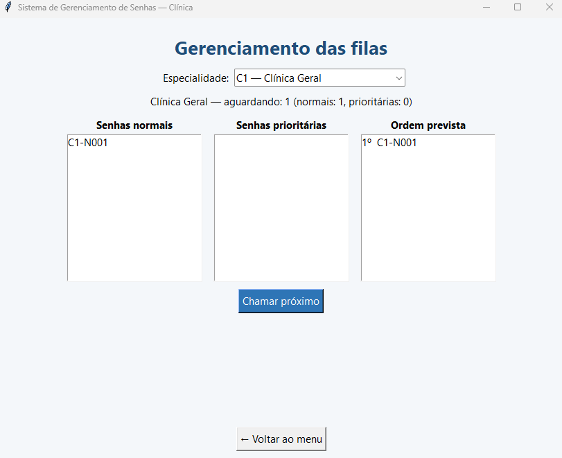
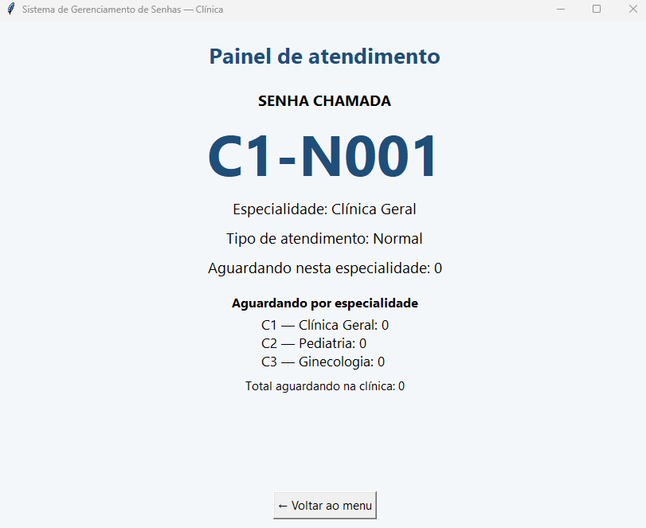
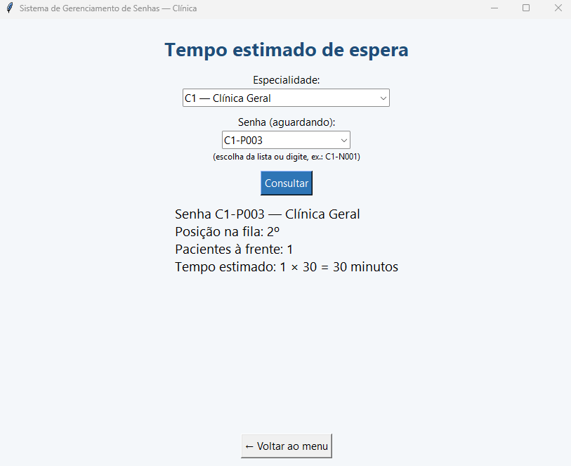

# Sistema de Gerenciamento de Senhas — Clínica Médica

Trabalho acadêmico da disciplina **Estrutura de Dados II**: um sistema em Python com interface gráfica em Tkinter que organiza o atendimento de uma clínica por meio de filas FIFO e filas de prioridade.

## Nome do Projeto

- **Gerenciamento de senhas para clínica**

## Integrantes

- **Guilherme de Souza Dutra RGM: 45604061**
- **Jhonny Herbert Cardoso Araújo RGM: 48456667**

## Situação-problema

Uma clínica médica atende diferentes especialidades, como Clínica Geral, Pediatria, Ginecologia, Cardiologia e Psiquiatria. Hoje, a organização das filas é feita manualmente, o que dificulta o controle da ordem de chegada, a identificação dos pacientes prioritários e o acompanhamento do tempo de espera.

## Objetivo do sistema

Organizar os atendimentos da clínica, desde a emissão da senha até a chamada do paciente, respeitando as prioridades e mostrando as informações em uma interface gráfica. O sistema:

- mantém uma fila independente para cada especialidade;
- gera senhas sequenciais identificadas por especialidade e tipo de atendimento;
- chama primeiro os pacientes prioritários, segundo a classificação do enunciado;
- calcula uma estimativa do tempo de espera de cada senha.

## Tecnologias e bibliotecas utilizadas

- **Python 3.10 ou superior**
- **Tkinter** (interface gráfica)
- Bibliotecas padrão do Python: `collections` (`deque`), `heapq`, `dataclasses` e `unittest`

Não é necessário instalar nenhum pacote externo.

## Estruturas de dados implementadas

Cada especialidade possui uma instância de `FilaAtendimento` (em `filas.py`), com duas estruturas:

| Estrutura | Uso | Inserção | Remoção |
|---|---|---|---|
| **Fila FIFO** (`collections.deque`) | Senhas normais, atendidas por ordem de chegada | `append` — O(1) | `popleft` — O(1) |
| **Fila de prioridade** (`heapq`) | Senhas prioritárias | `heappush` — O(log n) | `heappop` — O(log n) |

- Cada elemento do heap é a tupla `(nível de prioridade, número de chegada, senha)`. O heap escolhe o **menor nível** (1 é o mais urgente). Quando o nível é igual, vence o **menor número de chegada**, o que garante a ordem de chegada (FIFO) dentro da mesma categoria.
- Ao chamar o próximo paciente, o sistema retira primeiro do heap (prioritárias). Se ele estiver vazio, retira do `deque` (normais).
- A **consulta** da fila e da ordem prevista não remove ninguém das estruturas. Ela só lê o conteúdo, ordenando uma cópia das prioritárias e juntando com as normais.
- Cada senha é um objeto da classe `Senha` (`dataclass`), e cada especialidade tem um contador próprio e sequencial, compartilhado entre senhas normais e prioritárias.

### Classificação de prioridades (regra didática do exercício)

| Ordem | Categoria |
|---:|---|
| 1 | Pacientes com 80 anos ou mais |
| 2 | Pacientes idosos de 60 a 79 anos |
| 3 | Pessoas com deficiência (PCD) |
| 4 | Gestantes |
| 5 | Pessoas com obesidade |
| 6 | Pessoas acompanhadas de criança de colo |


## Funcionalidades disponíveis

- **Cadastro de especialidades:** até 3 entre as 5 disponíveis, sem repetição, com identificadores C1, C2 e C3.
- **Emissão de senhas:** escolha da especialidade, do tipo (Normal ou Prioritário) e da categoria de prioridade. Exemplos de senha: `C1-N001`, `C1-P002`.
- **Gerenciamento das filas:** lista as senhas normais, as prioritárias e a ordem prevista de atendimento, e permite chamar o próximo paciente. Avisa quando a fila está vazia.
- **Painel de atendimento:** mostra a última senha chamada, a especialidade, o tipo de atendimento e a quantidade de pacientes aguardando.
- **Tempo estimado de espera:** `pacientes à frente × 30 minutos`, calculado pela posição atual da senha na ordem de atendimento.
- **Validação de entradas:** operações inválidas mostram uma mensagem de erro, sem consumir a numeração das senhas.
- **Atualização automática** das telas após cadastrar, emitir ou chamar uma senha.

## Estrutura do projeto

```
.
├── app.py              # Interface gráfica (Tkinter) com as 6 telas
├── sistema.py          # Classe SistemaSenhas (regras de negócio)
├── filas.py            # Senha, FilaAtendimento (deque + heapq)
├── especialidades.py   # Especialidades e categorias de prioridade
├── exemplo_uso.py      # Demonstração do back-end pelo terminal
├── test_sistema.py     # Testes automatizados (unittest)
├── imagens/            # Capturas de tela da interface
└── README.md
```

A lógica de gerenciamento das filas (`sistema.py`, `filas.py`, `especialidades.py`) é independente da interface gráfica (`app.py`).

## Instruções para executar o programa

1. Instale o **Python 3.10 ou superior**. O Tkinter já vem com o Python no Windows e no macOS. No Linux (Ubuntu/Debian), instale com `sudo apt install python3-tk`.
2. Clone o repositório e entre na pasta:

   ```bash
   git clone https://github.com/Guilhermee11/Gerenciamento_de_senhas_para_clinica.git
   cd Gerenciamento_de_senhas_para_clinica
   ```

3. Execute a interface gráfica:

   ```bash
   python app.py
   ```

4. Cadastre as especialidades na tela 2 antes de usar as demais telas.

### Executar os testes

```bash
python -m unittest test_sistema -v
```

Os testes obrigatórios do enunciado correspondem a:

| Teste do enunciado | Função em `test_sistema.py` |
|---|---|
| 1 — Cadastro (3 especialidades e bloqueio da quarta) | `test_01_cadastro_maximo_tres_e_sem_duplicidade` |
| 2 — Emissão (5 normais e 4 prioritárias) | `test_02_emissao_cinco_normais_quatro_prioritarias` |
| 3 — Prioridade antes de normal anterior | `test_03_prioritaria_antes_da_normal_anterior` |
| 4 — FIFO na mesma categoria prioritária | `test_04_fifo_na_mesma_categoria_prioritaria` |
| 5 — Tempo estimado de espera | `test_05_tempo_de_espera_calculado_pela_ordem` |
| 6 — Fila vazia | `test_06_fila_vazia` |

Os demais testes verificam a ordem completa das seis categorias, a numeração por especialidade, as entradas inválidas e a independência das filas.

Para ver o back-end funcionando pelo terminal, sem a interface gráfica:

```bash
python exemplo_uso.py
```

## Imagens da interface gráfica


**Menu principal**



**Cadastro de especialidades**



**Emissão de senhas**



**Gerenciamento das filas**



**Painel de atendimento**



**Tempo estimado de espera**



## Vídeo demonstrativo

[Assista ao vídeo demonstrativo](https://drive.google.com/file/d/1TwaZ0jlsyAHF4U0rMQgy5Sz5g0C6imWd/view?usp=sharing)

O vídeo mostra o programa em execução, o cadastro das especialidades, a emissão de senhas, a chamada de pacientes, o painel, o tempo estimado de espera e os seis testes obrigatórios.
